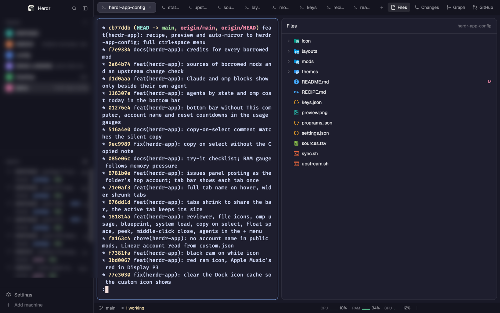
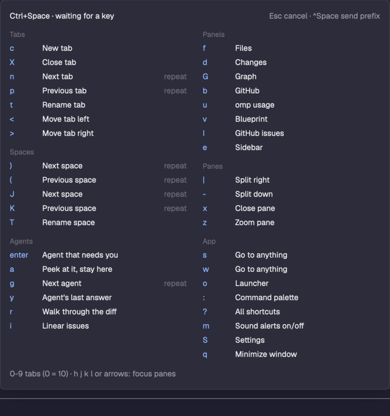
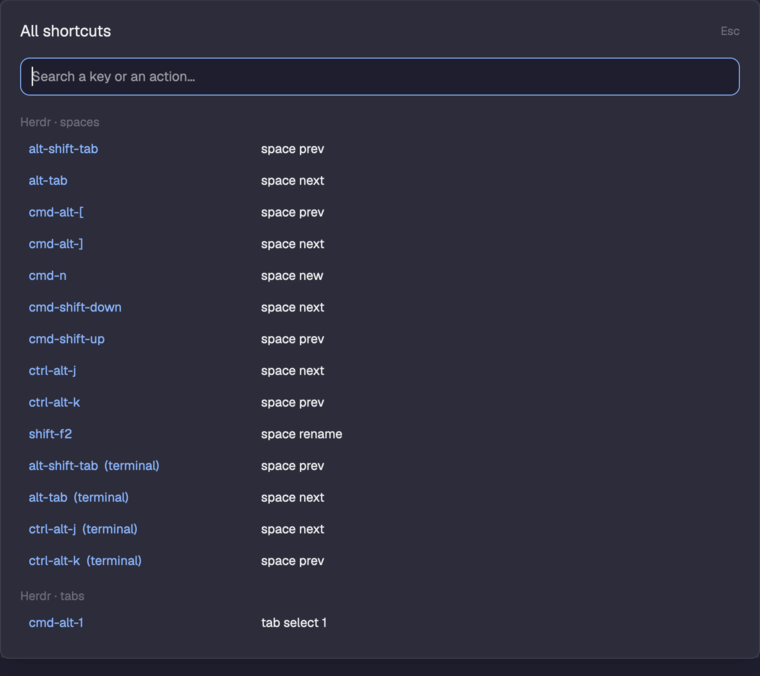
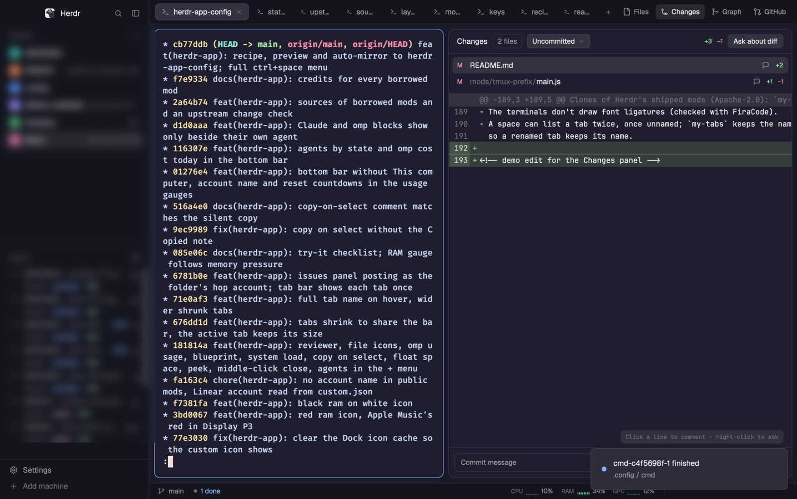
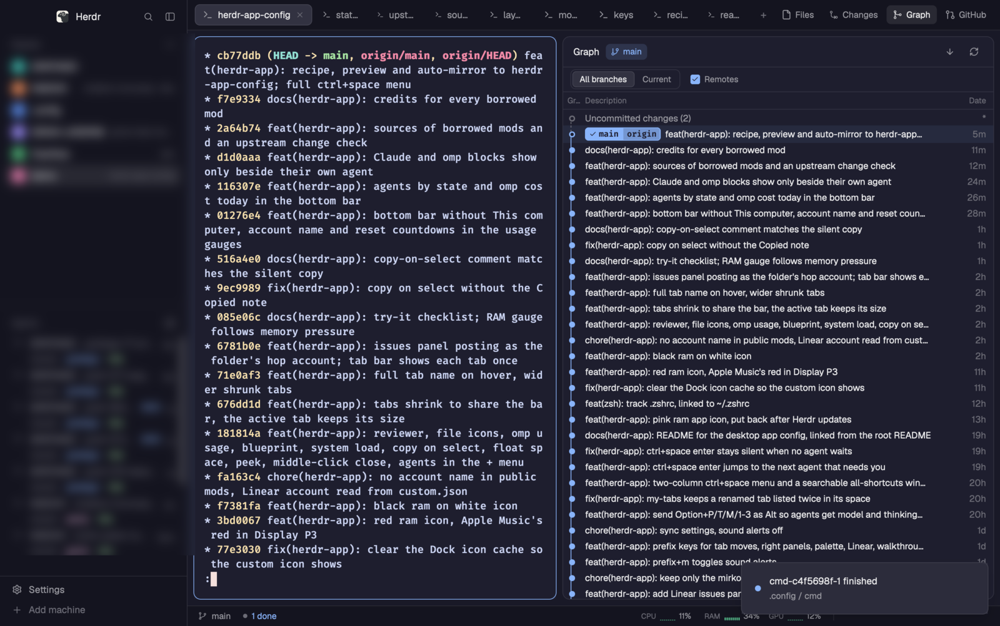

# Mirko's Herdr setup

## Install

Also on [herdr.dev/layouts](https://herdr.dev/layouts), under Community, as **Mirko**.
herdr.dev lists it by itself through this repo's `herdr-layout` topic, within an hour of each push.

You need macOS and the Herdr desktop app, opened at least once.
`gh` (GitHub panels) and `jq` (omp cost) are optional.

**With your agent**, the herdr.dev way. In a Claude Code (or other agent)
session inside Herdr, paste:

```text
Install the Herdr layout from https://github.com/mirkobozzetto/herdr-app-config
```

The agent reads `RECIPE.md` and Herdr's own instructions, copies the layout and
its mods, and keeps your current layout next to it.

**By hand:**

```sh
git clone https://github.com/mirkobozzetto/herdr-app-config ~/herdr-app-config
~/herdr-app-config/install.sh
```

The script copies everything into `~/.config/herdr-app` and switches to the
`mirko` layout. Whatever it replaces is saved first in
`~/.config/herdr-app/backup-<date>/`. Your own layout stays in the layout list.

## Update

```sh
cd ~/herdr-app-config && git pull && ./install.sh
```

## About

A keyboard-first setup for the [Herdr](https://herdr.dev) desktop app, made for
a day spent with many coding agents: one key shows every key, tabs never hide
the one you are on, and the bottom bar only talks about the agent in front of
you.



## What you get

| Ctrl+Space: every key at once | Cmd+/: every shortcut, searchable |
|---|---|
|  |  |
| **Changes: review a diff like a pull request** | **Graph: commit lanes** |
|  |  |


| Try | Do | You should see |
|---|---|---|
| Every key | `ctrl+space` | the whole menu, in two columns |
| All shortcuts | `cmd+/`, type "model" | the model keys of Claude Code, pi, omp and Prime Agent |
| Agent that needs you | `ctrl+space enter` | the blocked or finished agent; `enter` again: the next one |
| Peek | `ctrl+space a` | that agent over your tab; `esc` closes it |
| Tab bar | open many tabs, hover one | every tab fits, the active one keeps its size, the name shows on hover |
| Middle click | on a tab or an agent row | Herdr asks, then closes that tab |
| Panels | `ctrl+space` then `f`, `d`, `G`, `b`, `I`, `u`, `v` | Files, review, graph, GitHub, issues, omp usage, Blueprint |
| Bottom bar | look at it | agents by state, CPU, RAM, GPU; Claude gauges on a Claude terminal only |
| Copy on select | select text in a terminal | it is in the clipboard |
| Float space | `ctrl+shift+space` | a floating window with its own terminal and notes |

## Keys

### Ctrl+Space menu

Press `ctrl+space`, then one key.

| Group | Keys |
|---|---|
| Tabs | `c` new, `X` close, `n`/`p` next/previous, `t` rename, `<`/`>` move |
| Panes | `\|` split right, `-` split down, `x` close, `z` zoom |
| Spaces | `)`/`(` and `J`/`K` next/previous, `T` rename |
| Panels | `f` Files, `d` Changes, `G` Graph, `b` GitHub, `I` issues, `u` omp usage, `v` Blueprint, `e` sidebar |
| Agents | `enter` the agent that needs you, `a` peek at it, `g` next agent, `y` its last answer, `r` walk through the diff, `i` Linear |
| App | `s`/`w` go to anything, `o` launcher, `:` palette, `?` all shortcuts, `m` sound alerts, `S` settings, `q` minimize |

`0-9` select a tab, `h j k l` or the arrows move between panes, and
`ctrl+space` twice sends it to the program.

### Other keys

| Keys | Action |
|---|---|
| `cmd+/` | all shortcuts |
| `cmd+1..9` / `ctrl+1..9` | nth space / nth agent |
| `cmd+p` | launcher |
| `cmd+o` | space picker |
| `cmd+shift+t` | reopen the last closed tab |
| `cmd+shift+k` | walk through the diff |
| `cmd+shift+f`, `cmd+alt+f` | the agent's last answer, as a window or a dock |
| `ctrl+shift+space` | float space |
| `ctrl+shift+l` | back to the `mirko` layout |

On a keyboard where Option types characters (Belgian, French…), `option+p`,
`option+t`, `option+m` and `option+1..3` are sent as Alt, so the agents get
their model and thinking keys.

## Mods

| Mod | What it does | From | License |
|---|---|---|---|
| `tmux-prefix` | the Ctrl+Space menu | this repo | |
| `keys-help` | the all-shortcuts window | clone of Herdr's `help` | Apache-2.0 |
| `my-tabs` | tab bar that shrinks, names on hover, panel buttons | clone of Herdr's `tabs` | Apache-2.0 |
| `custom-status` | agents by state in the bottom bar | clone of Herdr's `workspace-status` | Apache-2.0 |
| `custom-omp-cost` | omp's cost today, on an omp terminal | this repo | |
| `agents-jump`, `spaces-jump` | agents and spaces lists with numbered jumps | [jorgeorejas/herdr-jump](https://github.com/jorgeorejas/herdr-jump) | Apache-2.0 |
| `reviewer` | review a diff like a pull request | [vytasgavelis/herdr-reviewer](https://github.com/vytasgavelis/herdr-reviewer) | none yet |
| `file-icons` | Files panel with Material icons | [amster93/herdr-file-icons](https://github.com/amster93/herdr-file-icons) | Apache-2.0 |
| `git-graph` | commit graph panel | [rabeeh-ta/herdr-git-graph](https://github.com/rabeeh-ta/herdr-git-graph) | MIT |
| `github` | GitHub panel and CI status | this repo | |
| `issues` | GitHub issues panel | [jankeesvw/herdr-issues](https://github.com/jankeesvw/herdr-issues) | none yet |
| `token-usage` | omp tokens and cost panel | [nakamotosai/herdr-agent-panels](https://github.com/nakamotosai/herdr-agent-panels) | MIT |
| `blueprint` | a live diagram of what the agent builds | [chappse6/herdr-blueprint-app](https://github.com/chappse6/herdr-blueprint-app) | MIT |
| `system` | CPU, RAM (memory pressure) and GPU | [Lakris2407/herdr-quota](https://github.com/Lakris2407/herdr-quota) | MIT |
| `claude-usage` | Claude gauges with reset countdowns | rewritten from [dev-gvs/herdr-claude-usage](https://github.com/dev-gvs/herdr-claude-usage) | none yet |
| `copy-on-select` | copy a selection on mouse up | [jspoynor/herdr-copy-on-select](https://github.com/jspoynor/herdr-copy-on-select) | none yet |
| `float-space` | floating scratch window | [thuanlm215/herdr-float-space](https://github.com/thuanlm215/herdr-float-space) | MIT |
| `fleece`, `fleece-dock` | the agent's last answer | [dmazlum/herdr-fleece](https://github.com/dmazlum/herdr-fleece) | MIT |
| `walkthrough` | a diff explained step by step | [dmazlum/herdr-walkthrough](https://github.com/dmazlum/herdr-walkthrough) | MIT |
| `launcher` | open a program | [EkeMinusYou/herdr-launcher](https://github.com/EkeMinusYou/herdr-launcher) | MIT |
| `space-picker` | open a folder as a space | [iqthink/herdr-space-picker](https://github.com/iqthink/herdr-space-picker) | MIT |
| `reopen-tab` | reopen closed tabs | [mustafaTokmak/herdr-reopen-tab](https://github.com/mustafaTokmak/herdr-reopen-tab) | MIT |
| `linear`, `linear-agent` | Linear issues, an agent per issue | [dantech99/herdr-linear](https://github.com/dantech99/herdr-linear) | MIT |
| `issue-agent` | an agent on a GitHub issue | [obrunogonzaga/herdr-mods](https://github.com/obrunogonzaga/herdr-mods) | MIT |
| `herdr-migration` | move tabs over from the terminal herdr | [CiprianSpiridon/herdr-migration](https://github.com/CiprianSpiridon/herdr-migration) | MIT |
| `ntfy` | phone ping when an agent needs you | this repo | |
| `path-menu` | context menus | clone of Herdr's `menu-plus` | Apache-2.0 |

Middle click to close is ported from
[ayayaQ/herdr-quick-close](https://github.com/ayayaQ/herdr-quick-close)
(Apache-2.0). Each author was told about this repo.

## Personal parts

These work here because of my own setup; on yours they stay quiet.

- `claude-usage` reads files written by my Claude Code status line.
- `issues` and `linear` read `~/.config/herdr-app/custom.json`, which is not in
  this repo: `{ "gh_users": { "<hop account>": "<GitHub login>" },
  "hop_account": "<account>" }`.
- The `+` menu adds omp and Prime Agent (`programs.json`).
- `icon/` holds my app icon and the script that puts it back after updates.

## Known limits

- Herdr can't turn off its corner notes, draw font ligatures, show a terminal
  scrollbar or select a rectangle.
- A space can list a tab twice; the tab bar shows each tab once.

## Maintaining

This repo is a mirror: the source is
[mirkobozzetto/dotfiles/herdr-app](https://github.com/mirkobozzetto/dotfiles/tree/main/herdr-app),
copied here on every push of the dotfiles.

```sh
bash herdr-app/sync.sh        # copy the app's files into the dotfiles
bash herdr-app/upstream.sh    # which borrowed mods changed upstream
```

`sources.tsv` lists each borrowed mod with the commit it was copied from.
