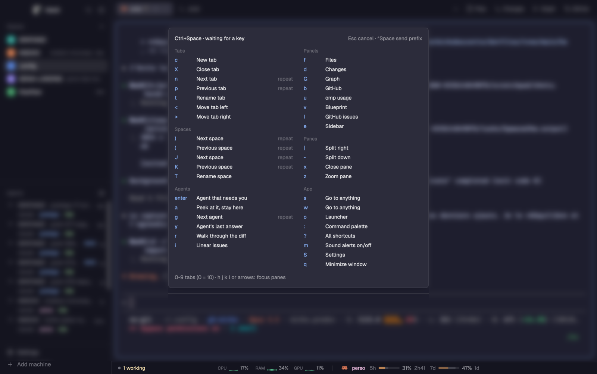

# Mirko

A keyboard-first Herdr window for a day spent with many coding agents: a
Ctrl+Space menu that shows every key at once, a searchable shortcuts window,
a tab bar that never hides the active tab, panels for files, review, issues
and usage on the right, and a bottom bar that only talks about the agent you
are looking at.

## What you see

- **Left sidebar, 268 px:** the brand row (shipped `workspace-chrome`), the
  spaces list with numbered jumps (`spaces-jump`), the agents list with
  numbered jumps (`agents-jump`), and the sidebar footer.
- **Top, 42 px:** the tab bar (`my-tabs`). Tabs shrink to share the bar, down
  to 72 px; the active tab keeps its full size. Each tab shows its program
  icon, its name (full name on hover), a spinner while it works, and a
  colored dot when its agent is blocked or done. On the right: `+`, and the
  Files, Changes, Graph and GitHub buttons.
- **Center:** the terminals. Pane headers show on hover only.
- **Right panel, 368 px, a stack:** Files with Material icons (`file-icons`),
  Changes as a pull-request review (`reviewer`), GitHub, a commit graph
  (`git-graph`), omp token usage (`token-usage`), a live diagram of what the
  agent builds (`blueprint`) and GitHub issues (`issues`).
- **Bottom bar, 28 px:** agents by state in color ("2 working · 1 needs you ·
  3 done", `custom-status`), CPU, RAM and GPU with small graphs (`system`),
  omp's cost today (`custom-omp-cost`), the Claude account with its 5-hour
  and weekly gauges and the time left before each resets (`claude-usage`),
  and CI status (`github`).
- **Theme:** Catppuccin Mocha in dark mode, Latte in light mode; FiraCode
  Nerd Font 14.

## How it behaves

- **Agent states:** working shows a spinner on its tab and a yellow count in
  the bottom bar; blocked shows a red dot and "needs you"; done shows a green
  dot. A click on "needs you" goes to the waiting agent.
- **Ctrl+Space (`tmux-prefix`):** a popup lists every key in two columns:
  tabs, panes, spaces, panels, agents, app. Enter goes to the next agent that
  needs you; `a` peeks at it over the current tab; `f d G b u v I` toggle the
  right panels; `?` opens all shortcuts; `0-9` select a tab.
- **Cmd+/ (`keys-help`):** every shortcut in one list with a search field:
  Herdr's keys, the Ctrl+Space menu, and the keys of Claude Code, pi, omp and
  Prime Agent.
- **Bottom bar follows the focused terminal:** the Claude block shows only on
  a Claude terminal, the omp cost only on an omp terminal.
- **Middle click** on a tab or an agent row closes its tab.
- **Copy on select:** a terminal selection is copied when the mouse comes up.
- **Ctrl+Shift+Space (`float-space`):** a floating scratch window with its own
  terminal tabs and notes.
- **Option keys on non-US layouts:** Option+P, Option+T, Option+M and
  Option+1..3 reach the agents as Alt instead of typing characters.

## Built from

- **Layout:** `layouts/mirko.json`, a root row (sidebar column, work column);
  the work column holds the tab bar, a row with the terminals and the right
  panel stack (`panel` > `panel-body`), and the `status-row`.
- **Shipped mods used as-is:** `workspace-chrome`, `toast`, `menu`, `picker`.
- **Clones of shipped mods:** `my-tabs` (tabs), `keys-help` (help),
  `custom-status` (workspace-status), `path-menu` (menu-plus), `agents-jump`
  and `spaces-jump` (agents and spaces, via jorgeorejas/herdr-jump).
- **Mods from other people:** listed with their license in `sources.tsv` and
  the README's Credits.
- **Keys:** `keys.json` (Ctrl+Space prefix, Cmd+/ help, Option-as-Alt lines in
  the `terminal` section, Ctrl+Shift+Space float space).
- **Programs:** `programs.json` adds omp and Prime Agent to the `+` menu.
- **Commands it runs:** `tab.*`, `pane.*`, `space.*`, `agent.focus`,
  `terminal.peek`, `layout.select|show|hide|resize`, `mod.open`. Programs run
  by mods: `gh` (github, issues), `git`, `hc`, `iostat`, `vm_stat`, `sysctl`,
  `ioreg`, `find`, `jq`, `osascript` (copy on select).

## Watch out

- `claude-usage` reads files written by the author's own Claude Code status
  line and hop accounts; without them it shows no limits.
- `issues` and `linear` read private settings from
  `~/.config/herdr-app/custom.json` (`gh_users`, `hop_account`), kept out of
  this repo.
- A space can list a tab twice, once unnamed: `my-tabs` and its `names.js`
  keep the named entry and hide empty tabs.
- The status row is tight on a narrow window: `system` is 292 px, `usage`
  380 px.
- Herdr can't turn off its corner notes, draw terminal ligatures, show a
  terminal scrollbar or select a rectangle; none of these mods try.

## Done when

- `herdr-app check mods/<name>` passes for every mod in `mods/`.
- `herdr-app status` shows no errors after `layout.switch:mirko`.
- Ctrl+Space shows the two-column menu without scrolling.
- Cmd+/ opens "All shortcuts" and typing "model" lists the agents' model keys.
- With 15 tabs open, all fit and the active one keeps its size.
- On a Claude terminal the bottom bar shows the account and both gauges; on a
  plain shell it does not.
